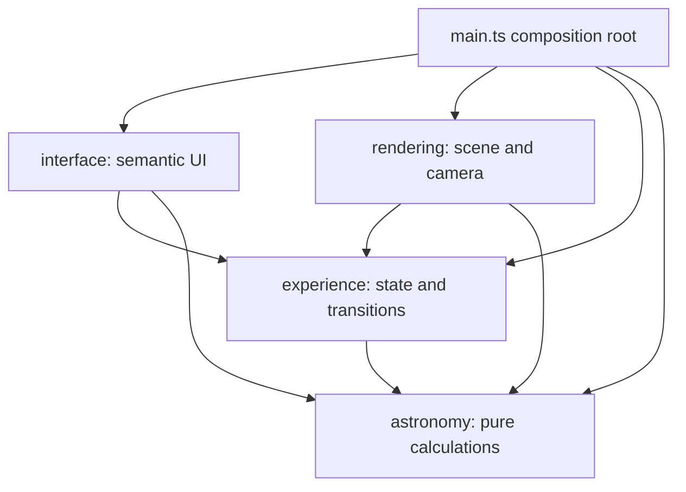

# Architecture Spine — Heliosphere free exploration

## Design Paradigm

**Layered architecture with functional core and imperative shell.** Astronomy calculates; experience governs state and transitions; rendering owns displayed geometry; interface owns semantic controls and explanations. `main.ts` wires these boundaries.

The finalized spec and all its companions remain binding. This spine governs consistency between the feature's implementation units; it does not replace their product or scientific contracts. No higher-altitude parent spine is inherited.

## Invariants & Rules

### AD-1 — Preserve the existing dependency boundaries [ADOPTED]

- **Binds:** All capabilities and integration work.
- **Prevents:** Scientific policy in rendering, DOM-dependent state transitions, and feature logic accumulating in the composition root.
- **Rule:** Astronomy remains pure and receives dates as arguments. Experience owns deterministic state and exhaustive actions, without DOM or Three.js. Rendering consumes typed snapshots and experience state; interface consumes state and dispatches actions. Neither adapter owns authoritative experience state. `main.ts` wires inputs, rendering, persistence and fallback; feature policy belongs in its owning module. The arrows below permit dependencies, never reverse imports.



### AD-2 — One mutually exclusive presentation mode [ADOPTED]

- **Binds:** CAP-1–CAP-5; scientific views, Gravity and Heliosphere entry/exit.
- **Prevents:** Concurrent schematics, competing return snapshots and inconsistent eligibility checks.
- **Rule:** The experience reducer owns one discriminated presentation state: scientific, gravity or heliosphere. Migrate Gravity into this model while preserving its contract; do not add parallel schematic flags. Scientific `ViewMode` remains exactly sun, space or galaxy. A schematic session holds one captured scientific return context; no nesting or direct schematic-to-schematic entry. The reducer enforces eligible free-exploration entry, paused entry/Back, Follow cancellation and trail resets. Back restores the captured view/valid selection, keeps explored planetary date/speed and stays paused; Home/journey transitions discard the session and use their baseline destinations. Heliosphere layers reset on each entry and never overwrite scientific overlay preferences.

### AD-3 — Keep calculated and displayed data separate [ADOPTED]

- **Binds:** CAP-1–CAP-4; snapshot construction, cards and scientific-view restoration.
- **Prevents:** A fourth scientific frame, translated Space coordinates leaking into schematic mapping, and visual compression changing physical values.
- **Rule:** Both schematics use an unchanged heliocentric JPL snapshot at the existing planetary UTC date, regardless of their captured return frame. Galactic elapsed time remains isolated. Physical cards derive distance, speed and periods from original scientific data. Schematic coordinates/radii, heliotail orientation and decorative phase never feed astronomy. Gravity's mapping and the scientific views' scale contracts remain separate from Heliosphere. Implementation updates PRD/SCIENCE for the agreed heliosphere exception in the same change that introduces it.

### AD-4 — Experience owns the stored decorative phase [ADOPTED]

- **Binds:** CAP-3–CAP-5; every decorative effect visible in Heliosphere.
- **Prevents:** Independent animation timers, playback-speed-dependent effects and phase jumps after pause or tab return.
- **Rule:** Experience owns one stored active-animation phase measured in nonnegative elapsed active presentation seconds, advanced from explicit real-time deltas independently of planetary speed. Rendering consumes seconds, not milliseconds, radians or normalized turns; it derives the 20-second boundary cycle from that value and samples the same value for outward flow and shimmer. Boundary breathing is ±2% per full cycle. The phase is presentation state, never another scientific clock. Advance only while Heliosphere is active, planetary playback is permitted and playing, the page is visible, and reduced motion is off. Pause, scrub, endpoint and hidden-tab actions freeze both planetary advancement and phase; scrub and visibility return leave playback paused. The shell delivers visibility changes before further advancement and resets its real-time baseline to prevent hidden-time catch-up. Explicit resume continues the retained phase. Reduced motion freezes decoration without blocking requested planetary playback or camera input; disabling it never starts a paused clock. Other visible decoration, including the Sun and any stabilized surface spin, must obey this freeze contract in Heliosphere; retain baseline animation behavior elsewhere.

### AD-5 — One rendering-owned heliosphere mapping [ADOPTED]

- **Binds:** CAP-1–CAP-3 and CAP-5; bodies, paths, labels, picking and camera targets.
- **Prevents:** Different compression/size rules across visuals and interactions, or Gravity surface geometry leaking into Heliosphere.
- **Rule:** One rendering-owned mapping defines Heliosphere scene positions and displayed radii from scientific inputs and agreed visual parameters. Radial distance compression is strictly monotonic. Meshes, orbit paths, label anchors, hit geometry and Focus/Follow consume that mapping or the resulting scene transforms; none reimplements its formulas. Preserve orbital phase/order, all-eight-planet readability, nested nonintersecting boundaries and containment inside the termination shock throughout the animation cycle. Mapping cannot depend on quality tier or planetary speed. Tail orientation is illustrative, not inferred from the Galactic travel model. Exact tuning remains local to this owner. Show the exact scale disclosure and the spec's geometry/animation disclosures in semantic UI.

### AD-6 — One selection and common region identities [ADOPTED]

- **Binds:** CAP-2 and CAP-5; cards, scene picking, region buttons, layers and Follow.
- **Prevents:** Concurrent planet/region cards, input-specific selection behavior and hidden-layer picks.
- **Rule:** Experience owns one tagged current selection: body, heliosphere region or none. Region selection is valid only in Heliosphere. Scene picks and semantic buttons dispatch the same region IDs; the interface owns the exact five explanations from the spec. Selection replaces the card without pausing, moving the camera or unhiding layers; region selection ends planet Follow. Escape clears the card and associated Follow. Rendering owns the geometry-to-region and layer-visibility lookup shared by drawing and picking. One rendering-owned hit resolver arbitrates marker, body and region hits and dispatches at most one selection per pointer activation; components must not dispatch competing hits independently. Exclude hidden surfaces from hit candidates; buttons remain available and existing explanations remain open. Labels affects scene labels only. Follow is allowed only for the selected planet and retains baseline cancellation rules.

### AD-7 — Coordinate camera and focus handoffs through one session [ADOPTED]

- **Binds:** CAP-1, CAP-3 and CAP-5; entry, Back, Home and journey transitions.
- **Prevents:** Stale camera restoration, lost entry/exit transitions between frames and separate camera/UI interpretations of Back.
- **Rule:** Experience owns saved frame/bookmark/eligible selection and accepted enter/Back/discard intent. The camera controller alone owns actual camera position and target; no Three.js objects enter experience state. Associate one saved pose with the same schematic session as the return context. Process every accepted handoff in order, including multiple actions before a render: capture once on entry, restore only on matching Back, discard on Home/journey exits. Clear pending camera moves, damping carry-over and Follow movement during handoffs. Interface applies focus from that same intent: Back on entry, the corresponding presentation's entry button on Back, baseline focus destinations on other exits. For Heliosphere that button is Explore Heliosphere; Gravity retains Sun's Gravity. Focus/Follow and clipping constraints use the active presentation's displayed body positions/radii. Reset uses Heliosphere's cutaway overview or Gravity's existing oblique overview, respectively. In Heliosphere, mouse/touch and semantic camera buttons reach the same camera operations, with native control key behavior taking precedence. No automatic orbit.

### AD-8 — Preserve the static delivery and resource envelope [ADOPTED]

- **Binds:** All capabilities; loading, quality, privacy and operations.
- **Prevents:** A runtime service dependency, schematic state leaking into sharing/preferences, and adaptation changing the lesson.
- **Rule:** Retain the existing static GitHub Pages repository-subpath build and deployment pipeline, local dev/preview environments and scene-construction fallback boundary. No new service, authentication, analytics, cookies or remote reporting. Runtime resources resolve to bundled static assets under the configured base. Heliosphere session state, selection, phase, layers and camera return pose never enter URLs or storage; sharing is disabled and explained at the interface and guarded at the share boundary. Preserve the scientific URL/preference allowlists and Gravity behavior. Renderer owns allocation, reuse and disposal of feature GPU resources and renderer-created DOM; interface owns its semantic controls and panels. Deferred resources stay within the existing roughly 3 MB critical/15 MB total compressed budgets. Adapt detail/density and pixel ratio to the existing 60 FPS laptop/30 FPS phone targets without changing astronomy, region identities, selectable access, phase cadence, mapping or nesting. Keep essential explanations and controls available in semantic HTML and retain the existing WebGL fallback. New/replaced bundled imagery requires ASSET_CREDITS updates; scientific and visual sources remain credited.

## Consistency Conventions

| Concern | Convention |
| --- | --- |
| Region IDs | `solar-wind`, `termination-shock`, `heliosheath`, `heliopause`, `interstellar-space`; shared typed domain IDs, never mesh indexes or translated labels. |
| Layers | Outer heliosphere, Termination shock, Orbit paths, Labels; owned by the active heliosphere session and initially on. The rendering owner supplies the common surface/layer association. |
| Units | Scientific dates remain UTC milliseconds and scientific distances AU; mapped coordinates/radii are explicitly illustrative scene units. Stored animation phase is elapsed active presentation seconds. |
| Mutation | All feature state changes pass through experience actions; camera commands and DOM focus are adapter effects of accepted actions. Rendering cannot mutate the scientific snapshot or experience state. |
| External boundaries | Validate URL/storage inputs using the existing allowlists; widen neither to accept schematic state. Do not serialize the application state wholesale. |

## Stack

Existing repository seed checked against `package.json`, lockfile and CI on 2026-10-28; these are retained versions, not upgrade instructions. Code and lockfile own subsequent version changes. No new dependency is required.

| Name | Version |
| --- | --- |
| TypeScript | 6.0.3 |
| Three.js | 0.186.1 |
| Vite | 8.3.1 |
| Node.js | 24.x; repository engine `^24.0.0`, CI major 24 |
| npm | 11.20.0 |

## Structural Seed

File names below are an initial placement guide; ownership rules above survive refactoring.

```text
src/
  experience/experience-state.ts     presentation union and authoritative transitions
  experience/heliosphere.ts          feature state, shared IDs and phase policy
  rendering/heliosphere-mapping.ts   pure display mapping and visual parameters
  rendering/heliosphere-presentation.ts  cutaway, effects and region geometry
  rendering/scene-camera-controller.ts   camera operations and session pose
  rendering/orbital-scene.ts         integration with existing bodies and labels
  interface/app-interface.ts        semantic controls, explanations and focus
  main.ts                           wiring and browser lifecycle input
```

Operational envelope remains browser-only: local development/production preview → existing GitHub Actions checks → static `dist/` deployment to GitHub Pages at `/Solar-System-Orbital-Journey/`. There is no feature-specific backend, environment, persistent data store, migration or remote operational reporting.

## Capability → Architecture Map

| Capability / Area | Lives in | Governed by |
| --- | --- | --- |
| CAP-1: cutaway and navigation | Rendering mapping/presentation, camera controller, semantic camera controls | AD-1, AD-2, AD-3, AD-5, AD-7, AD-8 |
| CAP-2: region explanations | Experience selection/IDs, rendering picking, interface content | AD-1, AD-5, AD-6, AD-8 |
| CAP-3: playback and return | Experience reducer, scientific snapshot wiring, camera handoff | AD-2, AD-3, AD-4, AD-7 |
| CAP-4: illustrative effects | Experience phase and rendering presentation | AD-3, AD-4, AD-5, AD-8 |
| CAP-5: accessible exploration | Semantic interface, shared actions, camera controller | AD-1, AD-4, AD-6, AD-7, AD-8 |
| Baseline, delivery and privacy | Existing modules, build/configuration and tests | AD-1–AD-3, AD-7, AD-8 |

## Deferred

- Exact aspect ratio, tail length, opening, compression function, body factors, hit-proxy geometry, camera limits and movement increments: the owning rendering/camera modules tune them within AD-5–AD-7 and the finalized spec; acceptance demonstrates all eight planets and all five scene-selectable regions.
- Materials, mesh resolution, effect implementation, star counts and lazy-allocation details: rendering owns these within AD-4/AD-8, preserving layered blue translucency, the dim diagonal Milky Way band and sparse static stars. The external reference image is inspiration, not a bundled dependency or source of measured geometry.
- Exact internal action names, session token representation, payload layouts and file splits: implementation chooses these within the single-owner rules; the shared public types are owned by experience, not independently invented by adapters.
- Per-story tests and rollout sequencing: follow the repository testing contract and the spec acceptance matrix. Implementation needs deterministic lifecycle/mapping tests, browser checks for access/return/sharing, Gravity regression coverage, and measured performance/transfer evidence. This architecture run verifies documentation only; application behavior, performance and learning outcomes remain unverified.
